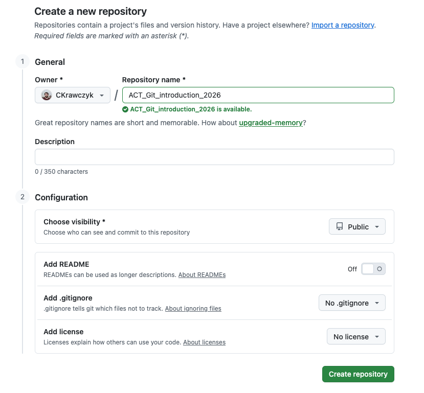
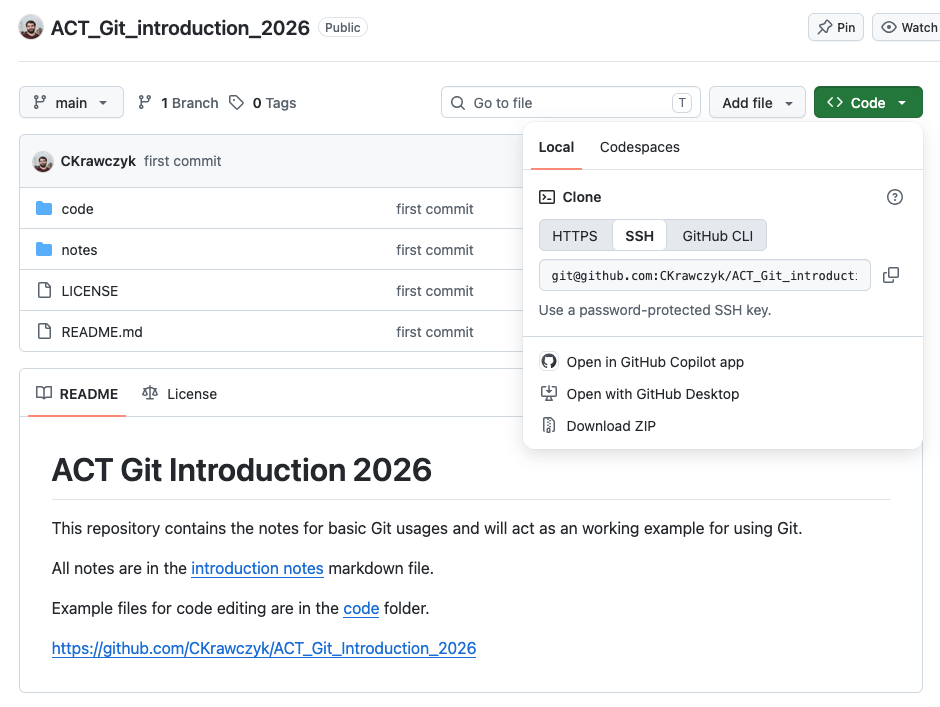
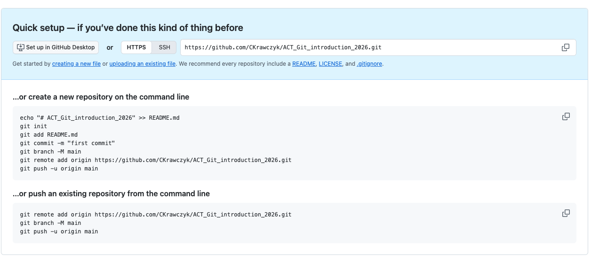

# Git and GitHub
At some point in your research you will likely have a massive hard drive crash, or realize you introduced a bug in your code and want to revert it back to its working state (perhaps from several weeks before).  Or you may end up working on a bit of code with other people.  In any of these cases version control saves the day.  This document with give you an introduction to `Git` and [`GitHub`](https://github.com/) as a version control solution.

## Before you start
+ Use linux for easiest setup and use locally as this will already have `git` installed by default
+ Create a `GitHub` account: https://github.com/
+ Set up ssh key with `GitHub` account: [Generate a new ssh key](https://docs.github.com/en/authentication/connecting-to-github-with-ssh/generating-a-new-ssh-key-and-adding-it-to-the-ssh-agent), [Adding an existing ssh key to GitHub](https://docs.github.com/en/authentication/connecting-to-github-with-ssh/adding-a-new-ssh-key-to-your-github-account) (Instructions are for linux or Mac based systems, you can do this on Windows but it might be a bit different than the instructions in the link)
+ Set up Two-Factor Authentication for `GitHub`: https://docs.github.com/en/authentication/securing-your-account-with-two-factor-authentication-2fa/about-two-factor-authentication (optional)

## Useful documentation
+ The Git Book: https://git-scm.com/book/en/v2

## Making a repo on GitHub
When you click on the "New repository" button on GitHub you will see the following:



Here you can enter in some information about your repo:

+ Repository name: the name of you repo and this will also be in the url for the repo
+ Description: Some test to start off your README file
+ Choose visibility: public repos have access to most GitHub features for free, as a student private ones can also get access to these features for free too (see https://education.github.com/pack)
+ Add README: If on this will place a README.md file in your new repo.  The README is a [markdown](https://github.com/adam-p/markdown-here/wiki/Markdown-Cheatsheet) file that is displayed on the repo's home page.
+ Add .gitignore: A `.gitignore` file tells git what files to ignore in a repo (e.g. `.pyc` files), there are useful templates for several languages you can start with.  If you are coding in python I would suggest picking it from the dropdown list.
+ Add a license: **Do this!**  You should always add a license to you code, if you are unsure what license to use click the [About licenses](https://docs.github.com/en/repositories/managing-your-repositorys-settings-and-features/customizing-your-repository/licensing-a-repository) button and read up on the different types.  I would recommend either the `MIT` license for your work.

### Clone a local copy
Now that you have a new repo online it is time to get a local copy on your computer.  Open a terminal and `cd` to the directory you want your repo to live.  On GitHub click the `<> Code` button, if you set up an ssh key click the "SSH" tab's link, if you did not, make sure you use the "HTTPS" tab's link.  Here is an example of an ssh tab:



Copy the link provided and go back to your terminal and type the command:
```bash
git clone <link you copied>
```

Note: on the University network you might need to enter some `git clone` or `git push` commands twice before they work.

## A note on authentication with GitHub

[See GitHub docs for more detailed information](https://docs.github.com/en/authentication/keeping-your-account-and-data-secure/about-authentication-to-github#authenticating-with-the-command-line)

There are two ways to authenticate with GitHub over the command line HTTPS and SSH.  SSH uses a physical file on you computer (encrypted with a passphrase) to log you into your GitHub account over the command line.  HTTPS will require you to set up a [personal access token](https://docs.github.com/en/authentication/keeping-your-account-and-data-secure/managing-your-personal-access-tokens) to act as you "password" when using the command line.  As setting up a personal access token take about the same amount of work as setting up an SSH key, it is recommended you just set up an SSH key instead.

### Note
 GitHub has created its own command line interface [GitHub CLI](https://cli.github.com/) that can log you in using your regular GitHub username and password and save the credentials for future `git` commands.

## Making a local repo
You can also make an existing folder into a git repo.  If you plan to keep back ups of this code on GitHub (like you should), start by making a blank repo on GitHub (see above) and just give it a name.  Once you do that you will see the following:



This gives you the step-by-step code for initializing your repo and setting the `remote` URL correctly.  Again, if you have `ssh` set up make sure you have the "SSH" button pressed, and if you don't make sure the "HTTPS" button is pressed.

Note: the `git push` command at the end will require GitHub authentication, see the section above for further details.

### Git without GitHub
You can also just use git without pushing your code up to GitHub.  To initialize git in a directory:
```bash
cd <dirctory>
git init
```

# Git setup
Before we start using git there are some basic configuration:
```bash
git config --global user.name "<your name>"
git config --global user.email "<your email>"
git config --global core.editor "<your text editor (defaults to vim)>"
```

Check that your configuration look correct:
```bash
git config --list
```

## Note: 
If you want to use `nano` as the default editor you can do that with:
```bash
git config --global core.editor "nano"
```

If you want to use `vscode` as the default editor you can do that with:
```bash
git config --global core.editor "code -n --wait"
```

## getting help
If you ever need help with a git command:
```bash
git help <command>
git <command> --help
```

# Git basics
Now that you have your repo set up it is time to learn how to use version control.  The basic workflow for `git` is: add/make changes to a file, stage files for a commit, commit the files to the repo, push commits to remote server (e.g. GitHub).

## checking the status of your repo
At any time you check the status of your repo (i.e. what files have changed, and what files are staged for commit) with:
```bash
git status
```
This screen helpfully tells you how to "undo" staged files (more on this below).

## staging files for a commit
You can stage changes for a commit by using the `add` command:
```bash
git add <file>
```
Or a if you want to add all files that have changed:
```bash
git add .
```
To unstage a file that was _never_ committed before (keeps local changes):
```bash
git rm --cached <file>
```
To unstage a file that was committed before (keeps local changes):
```bash
git reset HEAD <file>
```
To undo changes made to a file (revert it back to previous commit):
```bash
git checkout -- <file>
```


## commiting changes to a repo
After files are staged you can commit the changes using:
```bash
git commit
```
This will open a text editor for you to type a commit message into.  This should be a short description of what things were changed in the commit.  If your commit message is short you can also use:
```bash
git commit -m "<your commit message here>"
```
**Note** Once a commit has been made that version of the file will _always_ be in your repo.  You will always be able to return to this version of the code (this is the point of version control).  Because of this **_never_** commit sensitive information (e.g. passwords, private data, etc...) to a public repository.

## pushing changes to GitHub
If you have your remote repository set up (see above), you can push your commits with:
```bash
git push
```

## pulling changes from GitHub
If you are working on several computers, or you are working with other people, you can pull changes down from the remote repository with:
```bash
git pull
```

## code conflicts
If your local version of the code conflicts with the remote version of the code (e.g. the same file was edited) you will not be able to `push` or `pull` the code without resolving the conflicts.  Git will indicate were the conflicts are in the code with blocks that look like:
```
<<<<<<< HEAD
nine
=======
eight
>>>>>>> branch-a
```
Edit this block to look like the version you want, than stage the file with `git add`.  You can see where the conflicts are with `git status`.  Once all conflicts are resolved `git commit` your changes.

# Branches (and why you should use them!)
Git lets you keep several versions of you code at once via a branch system.  A good habbit to get into is to only use the `main` branch (the default first branch) for working/finished code, and use branches to test out new features.  Once the new feature is finished then it's branch is merged into the `main` branch.  

This is very useful if multiple people are working on the same code.  Each person works in their own branch, and when they are done they update their `main` branch to pull in the work of others, than merger their own work into `main` (and deal with any merge conflicts).

## list all your branches
```bash
git branch
```

## switch to a new branch
```bash
git checkout <branch name>
```

## to make a new branch (and switch to it)
```bash
git checkout -b <new branch name>
```

**Note** Any uncommitted changes are carried over when you make a new branch.  So if you started editing your `main` branch by mistake you can just make a new branch and not loose any of the changes you made or mess up your `main` branch.

## merging a branch
```bash
git checkout main
git merge <branch name>
```
If there are any conflicts during the merge resolve them as stated above.

**Note** In this example we are merging the branch into `main`, but `main` is just a branch like any other (there is nothing special about `main`).  You can merger any two branches.
